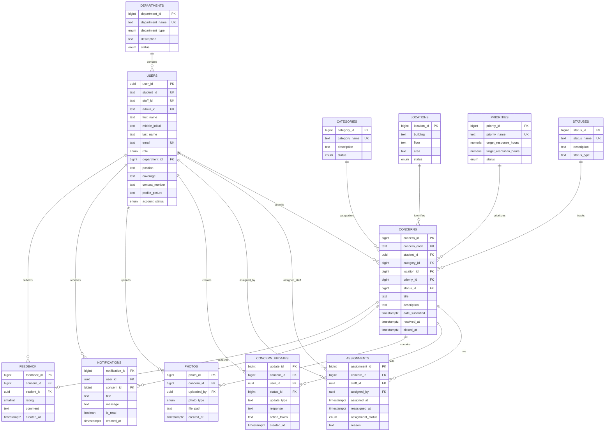

# CampusVoice ERD — Final Reference

The logical ERD uses the following entities and relationships.

### Supporting system tables
`WORKING_HOURS`, `HOLIDAYS`, `SYSTEM_SETTINGS`, and `ACTIVITY_LOGS` support configuration, calendar rules, system settings, and monitoring. They are not part of the main concern relationship chain but are included in the database implementation.
